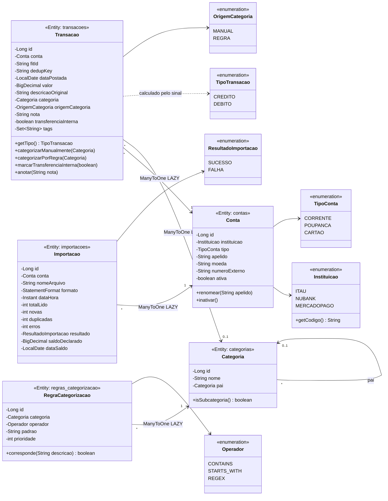
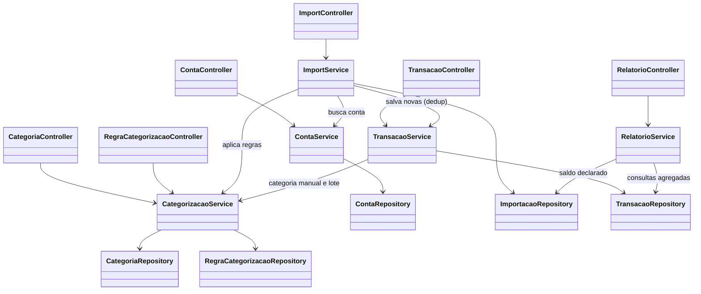
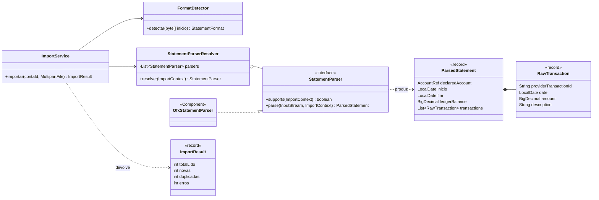
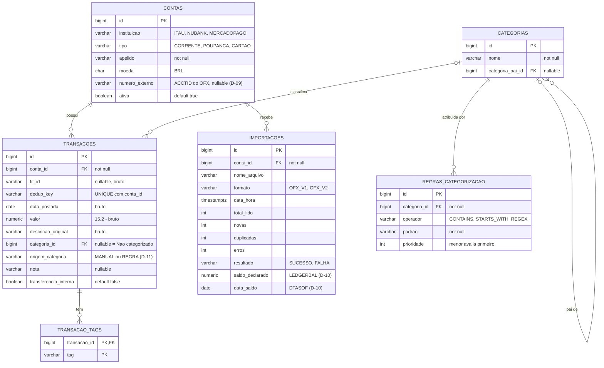

# Fintrack — Modelo objeto-relacional, camadas e banco de dados

| Campo | Valor |
|---|---|
| Projeto | Fintrack |
| Versão do documento | 0.2 |
| Documentos relacionados | `fintrack-srs.md`, `fintrack-arquitetura.md` (ADR-009) |
| Status | Aprovado — modelo **alvo** do MVP (D-09 a D-12 aprovados em 2026-10-20) |
| Última atualização | 2026-10-20 |

> Este documento detalha a §5 (modelo de dados) e a §6 (pacotes) da arquitetura em quatro visões:
> 1. **Entidades** (modelo objeto-relacional) — as classes JPA e seus relacionamentos.
> 2. **Camadas MVC** — controllers, services e repositories, e quem chama quem.
> 3. **Fluxo de importação** — como o parser OFX (Strategy, ADR-002) se encaixa nas camadas.
> 4. **Banco de dados** — tabelas, chaves e índices do PostgreSQL (migrations Flyway).
>
> Organização em camadas, sem módulos internos (ADR-009). Os diagramas usam Mermaid (renderizam no GitHub e no IntelliJ com o plugin Mermaid).
> Ele descreve o **alvo**, não o protótipo atual; a §6 lista o que muda no código existente.

---

## 1. Regras que moldam o modelo

| Regra | Origem | Efeito no modelo |
|---|---|---|
| Camadas: controller → service → repository | ADR-009 | Controller só fala com service; só service fala com repository. Controller nunca recebe nem devolve entidade — usa DTO. |
| Entidade JPA única | ADR-009 (resolve D-06) | A classe com `@Entity` é o modelo. Regras simples da própria entidade ficam nela (ex.: `inativar()`), não espalhadas no service. |
| Dinheiro é `BigDecimal` | ADR-003 | `BigDecimal` na entidade; `numeric(15,2)` no banco; string decimal no JSON. Nunca `double`. |
| Dado bruto imutável | RF11, RNF06 | Campos brutos sem setter e com `@Column(updatable = false)`. Enriquecimento em campos separados. |
| Dedup por `(conta, dedup_key)` | RF07, RNF04, ADR-005 | `dedup_key` calculada na importação + `UNIQUE (conta_id, dedup_key)` no banco. |
| Conta não é excluída | RF02 | Campo `ativa`; sem `DELETE` e sem cascade de remoção para transações. |
| "Não categorizado" | RF20 | `categoria_id = NULL` (sem linha especial na tabela). |

---

## 2. Entidades (modelo objeto-relacional)

**Decisões de mapeamento**

- **Relacionamentos só de um lado (unidirecionais).** `Transacao` aponta para `Conta`, mas `Conta` **não** tem `List<Transacao>`. Uma conta pode ter milhares de transações: a lista seria carregada sem paginação (fere o RNF03), e o `cascade = ALL` + `orphanRemoval` que existe hoje apagaria transações junto com a conta (fere o RF02). Para buscar transações de uma conta: `TransacaoRepository.findByContaId(id, pageable)`.
- **`fetch = LAZY` em todo `@ManyToOne`.** O padrão do JPA para `@ManyToOne` é `EAGER`, que dispara consultas extras sem você perceber (N+1 — guia `jpa-patterns`). Quando a tela precisar dos dados juntos, use `JOIN FETCH` ou `@EntityGraph` no repository.
- **Sem `cascade` de `Transacao` para `Conta`.** A conta já existe quando a transação é criada; o cascade `PERSIST` atual não tem função e pode criar contas por engano.
- **Campos brutos imutáveis:** `fitId`, `dedupKey`, `dataPostada`, `valor`, `descricaoOriginal` e `conta` com `@Column(updatable = false)` (ou `@JoinColumn(updatable = false)`) e **sem setter**. Valores só entram pelo construtor. Se o Lombok continuar, nada de `@Setter` na classe inteira de `Transacao`.
- **`tags`** via `@ElementCollection` → tabela `transacao_tags`.
- **`getTipo()`** é calculado (`valor < 0` → `DEBITO`) e não vai para o banco (`@Transient` não é necessário se não houver campo). O filtro por tipo (RF12) vira `valor < 0` / `valor > 0` na query.
- **Regra de categoria na entidade:** `categorizarPorRegra` não faz nada se `origemCategoria == MANUAL` (RF18). Fica na entidade porque é regra da própria transação, e é testável com `new Transacao(...)`, sem Spring.
- **Enums com `@Enumerated(EnumType.STRING)`**, nunca `ORDINAL`: reordenar o enum corromperia os dados.
- **Construtor sem argumentos `protected`**: o JPA exige, mas o código da aplicação usa o construtor completo.

---

## 3. Camadas MVC

**Regras das camadas**

| Camada | Pode | Não pode |
|---|---|---|
| Controller | Receber/validar DTO (`@Valid`), chamar **um** service, devolver DTO e status HTTP | Chamar repository, ter regra de negócio, devolver entidade, ter `@Transactional` |
| Service | Regra de negócio, `@Transactional`, usar o próprio repository e outros services | Conhecer HTTP (`HttpServletRequest`, `ResponseEntity`) |
| Repository | Consultas (Spring Data, `@Query`, paginação) | Regra de negócio |

- **Cada repository tem um "dono"**: o service da mesma entidade. Os outros services passam pelo dono (ex.: `ImportService` chama `TransacaoService`, não `TransacaoRepository`). Exceção: `RelatorioService`, que só lê e precisa de consultas agregadas.
- **Sem ciclos entre services.** Se `A` chama `B`, `B` não chama `A`. O diagrama acima não tem ciclo; mantenha assim.
- **DTOs** em `dto/request` e `dto/response`, como `record` com Bean Validation. Conversão entidade ↔ DTO por método estático no próprio DTO (`ContaResponse.from(conta)`), sem MapStruct (não está nos documentos).
- **Erros**: exceções de negócio próprias (`RecursoNaoEncontradoException`, `ArquivoInvalidoException`…) convertidas em `ProblemDetail` por um `@RestControllerAdvice`.
- **Testes** (RNF17): entidade testada como objeto comum; service testado com JUnit 5 + Mockito mockando os repositories, sem subir Spring; repository e importação ponta a ponta com teste de integração.

---

## 4. Fluxo de importação (Strategy + Factory — ADR-002)

Essas classes ficam no pacote `parser/` (exceto `ImportService` e `ImportResult`). `ParsedStatement` e `RawTransaction` não são entidades: só carregam os dados do arquivo até o `ImportService` decidir o que gravar.

**Atomicidade × auditoria (RNF05 × RNF12):** a importação é tudo-ou-nada (`@Transactional` no `ImportService`). Se der rollback, o registro em `importacoes` também sumiria. Para registrar a falha, a gravação da auditoria de falha precisa rodar em **outra transação** (`@Transactional(propagation = REQUIRES_NEW)`) em um **bean separado** — chamar um método `@Transactional` da mesma classe ignora a anotação (guia `jpa-patterns`, "Common Transaction Mistakes").

---

## 5. Banco de dados (PostgreSQL)

### 5.1 Constraints e índices

| Tabela | Constraint / índice | Motivo |
|---|---|---|
| `transacoes` | `UNIQUE (conta_id, dedup_key)` | Rede de segurança da dedup (RF07, RNF04, ADR-005). |
| `transacoes` | índice `(conta_id, data_postada DESC)` | Listagem paginada e filtro por período/conta (RF12, RNF03). |
| `transacoes` | índice `(categoria_id)` | Relatório por categoria (RF22) e filtro. |
| `transacoes` | `CHECK ((origem_categoria IS NULL) = (categoria_id IS NULL))` | Categoria e origem andam juntas. |
| `categorias` | `UNIQUE NULLS NOT DISTINCT (categoria_pai_id, nome)` | Evita "Alimentação" duplicada no mesmo nível. `NULLS NOT DISTINCT` (PostgreSQL 15+) faz o `UNIQUE` valer também para categorias raiz. |
| `importacoes` | índice `(conta_id, data_hora DESC)` | Histórico de importações e "último saldo" por conta (D-10). |
| todas as FKs | sem `ON DELETE CASCADE` | Nada é apagado em cascata; conta é inativada (RF02). |

### 5.2 Tipos

- Dinheiro: `numeric(15,2)`. Nunca `real`/`double precision` (ADR-003).
- Data da transação: `date` (hora é ignorada — arquitetura §4.2).
- Momento da importação: `timestamptz`.
- Enums: `varchar`.
- Schema criado por **Flyway** (`V1__schema_inicial.sql`), com `ddl-auto: validate` — o Hibernate só confere, não altera (resolve o item 10 da §7 do estado).

---

## 6. Do protótipo para o alvo

| Hoje (protótipo) | Alvo | Item no estado §7 |
|---|---|---|
| `Conta.id` = BANKID, atribuído à mão | `id` gerado; BANKID vem de `Instituicao.getCodigo()`; ACCTID em `numeroExterno` | 2 |
| `Transacao.id` = `Long.valueOf(FITID)` | `id` gerado + `fitId` (texto) + `dedupKey` + `UNIQUE (conta_id, dedup_key)` | 1 |
| `existsByApelidoOrInstituicao` | Removido; várias contas por instituição são válidas | 3 |
| `Transacao.categoria` com `@ManyToOne` + `@Enumerated` | `@ManyToOne(fetch = LAZY)` + `origemCategoria` | 4 |
| `Conta.transacoes` (`@OneToMany`, `cascade = ALL`, `orphanRemoval`) | Removido (relacionamento só do lado de `Transacao`) | — |
| `Transacao.conta` com `cascade = PERSIST` | Sem cascade, `updatable = false` | — |
| `Transacao.descricao`, `data` | `descricaoOriginal`, `dataPostada` (imutáveis, sem setter) | — |
| Pacotes `domain.model`, `domain.enuns`, `domain.services` | `model`, `model/enums`, `service` (ver arquitetura §6) | — |
| `ddl-auto: update` | Flyway + `ddl-auto: validate` | 10 |
| `LEDGERBAL` ignorado | Gravado em `importacoes.saldo_declarado` e usado no checksum (§7.4 da arquitetura) | 11 |

---

## 7. Decisões do modelo (D-09 a D-12)

Pontos que os documentos não cobriam, encontrados ao desenhar o modelo. **Todos aprovados em 2026-10-20.**

| ID | Lacuna | Decisão | Requisito afetado |
|---|---|---|---|
| **D-09** | A arquitetura §7.4 manda conferir se a conta declarada no arquivo bate com a conta escolhida, mas `Conta` não guarda nenhum número de conta. | Campo `numero_externo` (ACCTID) em `contas`, opcional no cadastro; preenchido na 1ª importação e conferido nas seguintes. Nunca logado (RNF08). | RF05, §7.4 |
| **D-10** | RF25 pede saldo por conta. Somar as transações só dá o saldo certo se o extrato começar na abertura da conta. | Saldo da conta = `saldo_declarado` (LEDGERBAL) da última importação com sucesso, com a data (`data_saldo`). Soma de transações fica para receitas/despesas. | RF25, estado §7 item 11 |
| **D-11** | RF18 (manual tem prioridade) + RF19 (reaplicar regras em lote): sem saber de onde veio a categoria, o lote sobrescreveria a escolha manual. | Coluna `origem_categoria` (`MANUAL` / `REGRA`); o lote só altera transações sem categoria ou com origem `REGRA`. | RF18, RF19 |
| **D-12** | Arquitetura §5.1 lista `Instituicao` como "dados de referência" (tabela); o código usa enum. | Manter **enum** com `codigo` (ITAU `0341`, NUBANK `0260`, MERCADOPAGO `0323`). Os bancos do MVP são fixos. Ajustar a §5.1. | RF01 |

Nomes: português nas entidades e enums de negócio (`CORRENTE`, `CREDITO`, `DEBITO`), conforme as instruções; `Operador` e `StatementFormat` ficam como na arquitetura (termos técnicos).

Registradas na §12 da arquitetura; §5.1 atualizada.

---

## 8. Histórico de versões

| Versão | Data | Mudança |
|---|---|---|
| 0.1 | 2026-10-20 | Primeira versão: domínio puro por módulo, padrão de mapeamento domínio ↔ JPA, diagrama ER, lacunas D-09 a D-12. |
| 0.2 | 2026-10-20 | Refeito para camadas MVC sem módulos (ADR-009): entidades JPA únicas com relacionamentos, diagrama de camadas controller/service/repository, fluxo de importação. Diagrama ER e lacunas mantidos. |
| 0.3 | 2026-10-20 | D-09 a D-12 aprovados. |
